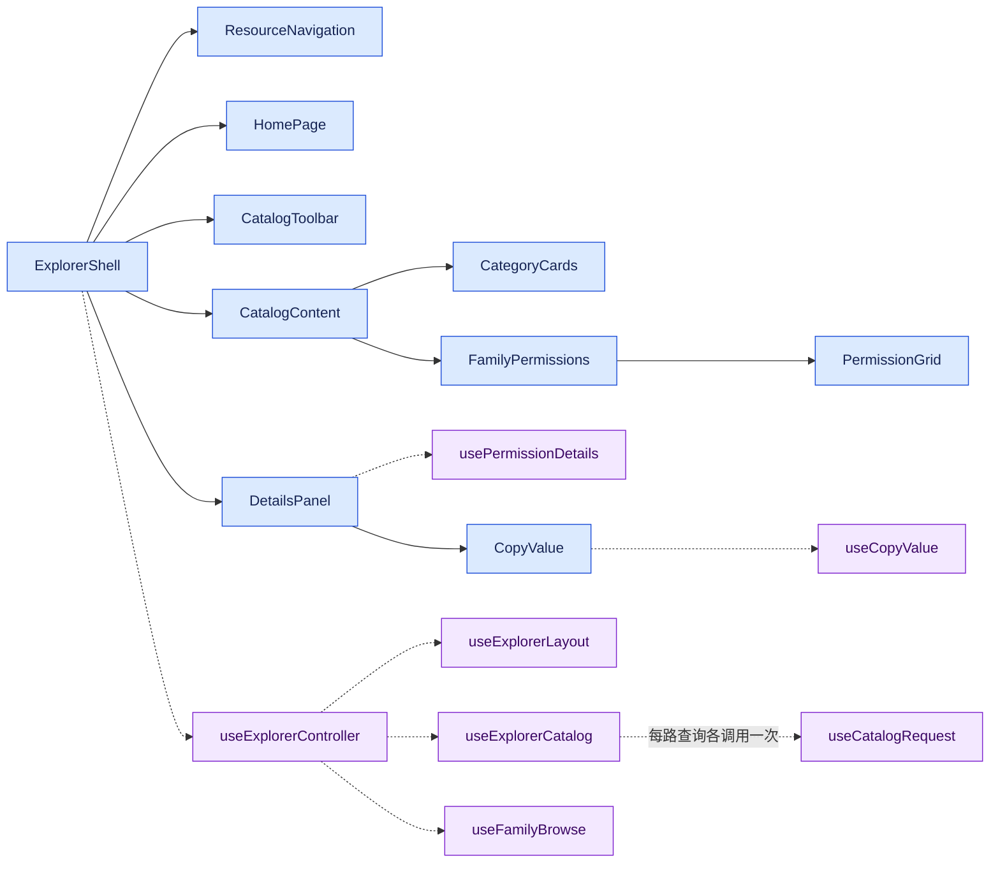
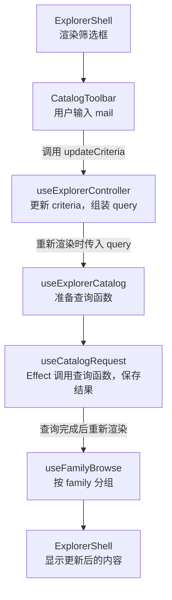

# Common UI · `@graph/ui`

`@graph/ui` 是独立网站和 SPFx Web Part 共用的 UI。宿主通过 `CatalogClient` 提供 permission 数据，可以通过 HTTP API 读取 SQLite 数据库，也可以从 JSON 文件读取。

## 前端入口

| 入口 | 数据来源 | 接入状态 |
| --- | --- | --- |
| [独立 Web](../../apps/web/src/main.tsx) | NestJS HTTP API | 已接入 |
| [SPFx Web Part](../../apps/spfx/src/webparts/permissionsExplorer/PermissionsExplorerWebPart.ts) | NestJS HTTP API | 已接入 |
| SPFx Web Part 的 SharePoint JSON 模式 | SharePoint 文档库中的版本化 JSON，下载后在浏览器中查询 | JSON client 已有，宿主配置和文件访问由 [#14](https://github.com/VigilanteWang/graphpermlist/issues/14) 接入 |

## 界面功能

- **Home** 和侧栏共用 `CatalogClient.resources()` 返回的目录。Home 为各 resource 显示计数、数据来源和浏览卡片。
- Microsoft Graph 先显示 category 卡片，进入 category 后按 family 分组。Power BI Service 和 SharePoint Online 直接按 family 浏览。新增 resource 由目录返回的浏览方式决定如何展示。
- **筛选框** 在 category 卡片页和 permission 列表页共用一份条件。进入 category 会缩小查询范围。切换 resource 时保留搜索词、permission 类型、admin consent 和 Show disabled，清除 family 筛选、当前 category 和打开的详情。普通浏览的 family 展开记录按 resource 和 category 保存。
- **permission 列表与 details**分别展示匹配当前筛选的定义和该 permission 的全部定义。details 面板支持复制名称和 GUID。

## 组件与 Hook 架构



<sub>蓝色为 React 组件，紫色为自定义 Hook。实线表示渲染子组件，虚线表示调用 Hook。</sub>

### 组件职责

| 组件 | 做什么 |
| --- | --- |
| [`ExplorerShell`](src/explorer/ExplorerShell/ExplorerShell.tsx) | 共享 UI 的入口，组合导航、首页和资源浏览页面。 |
| [`ResourceNavigation`](src/explorer/ExplorerShell/components/ResourceNavigation.tsx) | 在 Home 和各 API 资源入口之间导航。 |
| [`HomePage`](src/explorer/HomePage/HomePage.tsx) | 显示统计、资源卡片、使用说明和数据来源。 |
| [`CatalogToolbar`](src/explorer/components/CatalogToolbar.tsx) | 显示当前筛选条件，并把用户修改交给 `updateCriteria`。 |
| [`CatalogContent`](src/explorer/ExplorerShell/components/CatalogContent.tsx) | 根据 resource 的浏览方式和当前 category 显示 [`CategoryCards`](src/explorer/ExplorerShell/components/CategoryCards.tsx) 或 [`FamilyPermissions`](src/explorer/ExplorerShell/components/FamilyPermissions.tsx)。 |
| [`CategoryCards`](src/explorer/ExplorerShell/components/CategoryCards.tsx)、[`FamilyPermissions`](src/explorer/ExplorerShell/components/FamilyPermissions.tsx)、[`PermissionGrid`](src/permissions/PermissionGrid/PermissionGrid.tsx) | 分别显示 category 卡片、可展开的 family 分组和 permission 表格。 |
| [`DetailsPanel`](src/permissions/DetailsPanel/DetailsPanel.tsx)、[`DefinitionDetails`](src/permissions/DetailsPanel/components/DefinitionDetails.tsx)、[`CopyValue`](src/permissions/DetailsPanel/components/CopyValue.tsx) | 展示选中 permission 的完整定义，并提供名称和 GUID 的复制操作。 |
| [`DefinitionLabel`](src/permissions/components/DefinitionLabel.tsx)、[`MetadataTable`](src/components/MetadataTable.tsx)、[`RequestError`](src/components/RequestError.tsx) | 提供可复用的定义标签、元数据表和请求错误提示。 |

### Hook 与数据访问

| Hook 或接口 | 做什么 |
| --- | --- |
| [`useExplorerController`](src/explorer/ExplorerShell/hooks/useExplorerController.ts) | 管理页面、当前 category、筛选条件和键盘焦点，把数据和操作交给 [`ExplorerShell`](src/explorer/ExplorerShell/ExplorerShell.tsx)。 |
| [`useExplorerLayout`](src/explorer/ExplorerShell/hooks/useExplorerLayout.ts) | 观察 [`ExplorerShell`](src/explorer/ExplorerShell/ExplorerShell.tsx) 的容器宽度，判断是否需要窄布局。 |
| [`useExplorerCatalog`](src/explorer/ExplorerShell/hooks/useExplorerCatalog.ts) | 根据当前页面和筛选条件准备各路查询，并整理 family 选项。 |
| [`useCatalogRequest`](src/hooks/useCatalogRequest.ts) | 执行传入的查询函数，处理加载、失败、取消和重试。 |
| [`useFamilyBrowse`](src/explorer/ExplorerShell/hooks/useFamilyBrowse.ts) | 按 family 分组并保存展开状态。 |
| [`usePermissionDetails`](src/permissions/DetailsPanel/hooks/usePermissionDetails.ts)、[`useCopyValue`](src/permissions/DetailsPanel/hooks/useCopyValue.ts) | 分别加载选中 permission 的详情、管理复制结果。 |
| [`CatalogClient`](../contracts/src/catalog-client.ts) | UI 统一使用的查询接口。HTTP client 通过后端 API 查询 SQLite，JSON client 在浏览器中查询已加载的快照。 |

## 页面如何更新

以在某个 category 内输入 `mail` 为例：



1. **用户输入**。在 `CatalogToolbar` 输入 `mail`，筛选框调用 `updateCriteria({ q: 'mail' })`。
2. **组装查询**。`useExplorerController` 更新 `criteria`。重新渲染时，它结合当前 `category` 生成新 `query`。
3. **执行查询**。`useExplorerCatalog` 准备新的查询函数。渲染提交后，`useCatalogRequest` 的 Effect 调用该函数，通过 `CatalogClient` 查询数据。
4. **显示结果**。请求完成后保存结果并触发渲染。`useFamilyBrowse` 对返回的 permission 行分组并展开命中项，`ExplorerShell` 把结果交给内容区显示。

## 常用名词与查询结果

| 名称 | 含义与用途 |
| --- | --- |
| `criteria` | 筛选框保存的条件，例如搜索词、permission 类型、family 和是否显示禁用项。 |
| `category` | 按配置为 permission 划分的大类，例如 Graph 的 Exchange。 |
| `family` | 在 resource 或 category 中显示的 permission 分组，例如 `Mail`。每组可以展开查看其中的 permission。 |
| `query` | 结合 `criteria` 和当前 `category` 得到的查询参数。 |
| `catalog` | 此处指 `useExplorerCatalog` 返回给页面的查询状态和派生数据。 |
| `resources` | API 资源列表和目录状态。Home 和侧栏使用同一份结果，并按 Resource App ID 定位选中的 resource。 |
| `categories` | category 列表和计数，用于显示分类卡片。 |
| `rows` | 当前 resource 或 category 中符合查询条件的 permission 行，用于 family 分组和表格。 |
| `familySource` | 包含禁用项的 permission 查询结果，用于生成独立于当前筛选的 family 选项。旧版单资源目录也用它补读 Home 的 definitions 总数。 |

## 接入与验证

前端应用创建好 `client` 后，从公开入口导入并挂载 `ExplorerShell`。独立网站通过 `viewportLayout` 启用视口布局。SPFx 使用默认的嵌入布局，也可以通过 props 提供主题或主题模式。

```tsx
import { ExplorerShell } from '@graph/ui';

<ExplorerShell client={client} hostLabel="Standalone website" viewportLayout />
```

