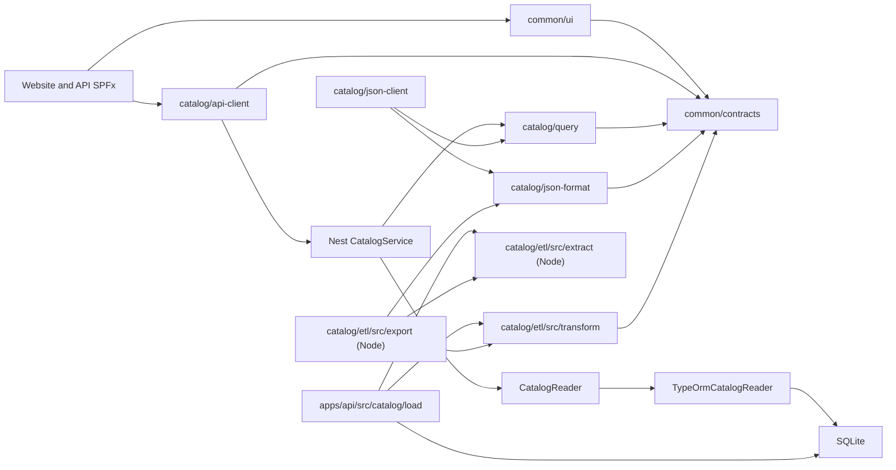

# SharePoint JSON increment

Parent: [#11](https://github.com/VigilanteWang/graphpermlist/issues/11).
Latest issue bodies are authoritative; this file records decisions and evidence.
The [V1 plan](implementation-plan.md) remains historical. No previous SharePoint
runtime gap is reclassified as passed by this increment.

## Sequential stages

1. [#12](https://github.com/VigilanteWang/graphpermlist/issues/12): neutral client,
   snapshot contracts, pure query core and existing-entry regression.
   [PR #16](https://github.com/VigilanteWang/graphpermlist/pull/16) merged into main.
2. [#13](https://github.com/VigilanteWang/graphpermlist/issues/13): offline export,
   validation, publication files and browser JSON client. See the
   [stage 2 handoff](#stage-2-delivery-and-verification).
3. [#18](https://github.com/VigilanteWang/graphpermlist/issues/18): module migration,
   CatalogReader and configurable multi-resource catalogs with schema 2. Starts from
   PR #17 merged into main at `c5e4132`.
4. [#14](https://github.com/VigilanteWang/graphpermlist/issues/14): website and existing
   SPFx configuration for API or JSON and SharePoint file transport.
5. [#15](https://github.com/VigilanteWang/graphpermlist/issues/15): independent review,
   clean reproduction and actual SharePoint runtime acceptance across both modes.

Each stage starts from verified latest main after its predecessor PR merges. Use
one codex/ branch and PR per stage. No merge, issue closure, tenant upload, permission
change or deployment is authorized by successful checks. Stop after each stage.

## Product and code boundaries

The website and existing SPFx use the same `common/ui` and inject a neutral
`CatalogClient`. The final delivery keeps one solution, Web Part and sppkg with
existing IDs and package name. #14 owns website build-time selection and SPFx
initialization from a SharePoint configuration file, including existing API property
compatibility. #15 owns actual SharePoint runtime acceptance.

- `common/contracts` exposes type-only client, query, model, HTTP and JSON contracts.
- `catalog/query` provides pure filtering, merging, counts and details through
  `@graph/catalog-core`. The Node API and JSON client share this package.
- `catalog/api-client` provides `createApiCatalogClient()` and its compatible
  `createCatalogClient()` alias. `catalog/json-client` provides `JsonCatalogClient`.
- `catalog/json-format` validates both file formats via
  `@graph/catalog-json/validation`. The offline CLI manages file I/O under
  `catalog/etl/src/export`, using the same validation as the browser.
- `catalog/etl/src/extract` retains the Node-only `@graph/catalog-source` entry for
  resource manifests, source validation and sanitization. `catalog/etl/src/transform`
  provides pure modeling and classification through `@graph/catalog-ingest`.
  The JSON exporter and the SQLite writer in `apps/api/src/catalog/load` consume
  the same transform output. Browser paths use the query and format packages.
  JSON runtime requires no Nest, SQLite or customer Azure resources.

All query filters act on the same definition before value merging. Same-type,
same-value definitions with different GUIDs survive. Counts and visibleTypes use
matching definitions; detail.allDefinitions retains all definitions of the exact
case-sensitive value. Disabled is hidden by default; upstream validation/import
excludes RSC. Unknown category/family yields no matches. Text sorting remains JS
lexical ordering; definitions sort by type, with stable input order within a type.

## Schema 1 decisions for #13

The [JSON contract](../common/contracts/src/catalog-json-format.ts) describes the static
schema. Stage #13 implements runtime validation.

- CatalogJsonManifest: schemaVersion: 1, version, snapshot, artifactSha256.
  snapshot is a filename relative to the configured manifest directory, such as
  catalog-<version>.json. Version/path validation must reject absolute URLs,
  schemes, encoded separators, dot segments and directory escape. The host can
  configure a different site path on its own origin with real file access.
- CatalogJsonSnapshot: schemaVersion: 1, version, source, classificationHash, resources.
  Each resource includes resourceId (Resource App ID), displayName, categories,
  category/family pairs and definitions. Each definition has value/category/family,
  the current PermissionDefinition and safe rawDefinition fields (Application
  allowedMemberTypes/origin/displayName/description; Delegated type/admin/user
  consent fields). Do not retain tenant/object/credential fields. Validation must
  check raw/normalized field agreement, type/consent/enabled rules and references.
- Definition identity is resourceId + permissionType + GUID. Display row identity
  is resourceId + value. Same value must have consistent category/family. Distinct
  GUIDs must never be deduplicated by value. Resource/category/family identifiers
  and references must be validated before any core query.
- source.sha256 hashes original input bytes; source.fileName is a safe logical
  name, never a private input path. source.classificationVersion and top-level
  classificationHash identify classification; source.excludedRscCount traces RSC.
- CatalogJsonSnapshotSource.generatedAt is the actual offline generation timestamp
  (UTC ISO 8601). CatalogImportSource.importedAt is the real database import time.
  Both source types share the input file name, digest and classification fields.
  Deterministic reproduction requires the same input/rules/schema/generation
  timestamp; #13 must provide an explicit reproducible timestamp input.
- manifest.artifactSha256 is lowercase SHA256 over the exact snapshot file bytes,
  not the parsed/re-serialized object. Keep it outside the snapshot to avoid a
  circular self-digest. The client adds optional CatalogQueryMetadata.artifact with
  schemaVersion/version/sha256 only after validation; API need not emit it.
- Manifest and snapshot schema/version must agree. An unsupported schema, invalid
  shape, duplicate identity, inconsistent reference/raw fields or digest mismatch
  rejects the candidate. No fallback to empty directory on corrupt/missing data.
  Static types do not establish runtime trust; unknown fields also need policy.
- #13 should set and document finite byte/record/string/depth limits based on the
  measured source, with tests at boundaries and explanations. Current input counts
  are acceptance evidence, never schema requirements for future valid catalogs.

CatalogJsonClientError.code defines load-failed (network, other unsuccessful status
or login HTML), permission-denied (401/403), file-not-found (404), invalid-snapshot
(format, reference, digest, version or limits), unsupported-schema and not-found
(resource or detail query). JSON errors reject promises. Cancellation uses
AbortError and stale requests cannot publish state. HTTP retains CatalogApiError
with original status/body.
not-imported is the existing API's migrated/unimported database state; it is not a
JSON read-failure fallback. A valid zero-result query is ready with empty items.

A session pins one fully validated snapshot. Search/filter/detail reuse it without
new downloads. Explicit refresh rereads manifest, loads/verifies a candidate and
atomically replaces only in-memory state on success; failure keeps the last valid
snapshot with an observable error. Concurrent loads, cancel/retry and stale results
must not mix versions. Initially no persistent/offline cache is required.

Offline publication order: validate -> upload immutable snapshot -> confirm readable
-> switch current.json last. Rollback switches to a previously valid version. No
SharePoint multi-file transaction is assumed. Digest checks integrity, not publisher
trust or authorization. Upload/permission/runtime testing still needs separate user
authorization and an actual designated test environment.

## Module and build decisions

catalog-core compiles one source twice: ESM under dist/esm and CommonJS under
dist/cjs with a generated package marker. Conditional exports select import/require
and corresponding declarations. main/module/types also support the current SPFx
node-resolution tooling. There is no handwritten second query implementation.
Node API remains CommonJS; contracts remain type-only imports; no sync require(ESM)
feature or top-level await assumption is needed. Browser core is compiled with
ES2020/DOM and types: [] so Node ambient types are unavailable. Other hosts retain
their existing TS configurations. No global toolchain override or dependency upgrade.
Root npm ci still installs the entire workspace, including backend/tooling packages.

Checks recurse through shared source ASTs and runtime manifests, rejecting
unapproved packages, Node builtins, host/identity imports and relative escapes.
Both compiled core exports must be runtime-dependency-free. React remains a UI peer
provided by each host. Existing SPFx package and React manifest checks still apply.
[Microsoft compatibility reference](https://learn.microsoft.com/en-us/sharepoint/dev/spfx/compatibility)
was rechecked: retain SPFx 1.24.1, React 18.3.1 and pinned Node 22.16.0/TS 5.8.3.
This stage does not add a JSON Web Part or claim a second package already exists.

## Stage 1 baseline and verification — 2026-11-17

Fetched live #11/#12, related #2/#6 and PR #10 metadata. git fetch origin confirmed
HEAD = origin/main = c6310f38e138138901966a219b94b2f3948f2f1f, the #10 merge.
Only one worktree existed. The pre-existing implementation-plan research/planning
appendices were retained, then codex/spfx-json-1-query-core was created from main.
No source/database/service changes existed at start. Current AGENTS.md reflects #11
without overwriting V1 history. Main model cannot be independently verified/switched
through current tools; no global settings changed. A bounded Sol/medium test author
and read-only reviewer was explicitly launched; main owns integration/manifests/Git.

Verification results and publication identifiers will be appended below after checks.

### Stage 1 results

Node 22.16.0 / npm 10.9.2, macOS arm64; commands run at repository root:

| Command/check | Verified result |
| --- | --- |
| npm ci | Passed initially and after local workspace lock update; final 1,425 packages. No registry version changes. |
| npm run verify:data | Passed pinned source SHA256; Application 788, Delegated 876, disabled 4, excluded RSC 60. |
| npm run typecheck | Passed all packages and fixtures; new snapshot/legacy-client fixture also passed `npx tsc -p tsconfig.tests.json`. |
| npm test | 26 passed, 0 failed. Existing real-source HTTP oracle, transaction/CLI tests plus 12 explicit ESM/CJS synthetic query tests. |
| npm run build | Passed shared/API/Vite and existing SPFx production lint/build/package. Existing host IDs/properties and build configurations unchanged. |
| npm run check:react | Passed React 18.3.1/manifest and recursive shared dependency checks; both core outputs have no runtime imports. |
| Boundary negative probes | Four nested temporary probes rejected Node builtin, Nest import, relative escape and dynamic nonliteral import; probes removed and clean check passed. |
| node docs/verification/spfx-json-1/runtime-check.mjs | Passed isolated file SQLite migration/import/reuse plus new real CommonJS API process. All four routes, original source shape, counts/GUID/consent/400/404/CORS/OPTIONS verified. Process/database cleaned up. |
| CATALOG_TEST_API_PORT=3216 CATALOG_TEST_WEB_PORT=5316 npm run test:browser | 26/26 Chromium passed (29.8s), including real browser core ESM and neutral generation-time metadata. Existing services and local database were not used or stopped. |
| Chinese comment / diff checks | 8 changed source modules, 78/78 named declarations have Chinese TSDoc/JSDoc plus headers. Manual purpose/rules/data-flow/domain-term accuracy review and git diff --check passed. |

[Sanitized command logs, runtime helper and package hash](verification/spfx-json-1/).
[Actionable human-review checklist](verification/spfx-json-1-human-review.md).
The core test author also performed a bounded read-only final review of contracts,
core/provider and UI compatibility; no concrete remaining issue found. Main agent
reviewed integration, lock changes, source comments and retained artifact hygiene.
The only post-build source edit was clarification of Chinese type comments; no
runtime/type behavior changed, so unrelated checks were not repeated.

Initial added browser test collection failed because import.meta.url interacted with
Playwright's CommonJS transformation; fixed the test-only path derivation. Chromium
then could not initialize under macOS sandbox MachPort restrictions; an approved
full rerun passed. See execution-limitations.txt. Upstream install deprecations,
Vite chunk-size warning and Heft zero Web Part Jest suites persist. Browser baseline
versions beyond installed Chromium, other OS/platforms and hosted CI are unverified.
SPFx packaging is successful, but actual SharePoint runtime remains unverified.

This stage deliberately delivers one existing API SPFx package, not a second/JSON
package; those #11 deliverables belong to #14. JSON validators/export/loader/refresh,
file permissions/HTML/digest failure handling and publication/rollback are contracts
only here and require implementation in #13. No tenant access, uploads, permissions,
app registrations, deployment, merge, issue closure or next-stage work performed.

### Stage 1 publication and stop

Implementation/evidence commit:
[ac70855](https://github.com/VigilanteWang/graphpermlist/commit/ac70855115ed9dc53668e4e265bffaf6bd0d78c2).
[PR #16](https://github.com/VigilanteWang/graphpermlist/pull/16) targets main from
codex/spfx-json-1-query-core and is Ready for review. Published the actionable
[#12 human-review checklist](https://github.com/VigilanteWang/graphpermlist/issues/12#issuecomment-6951418159),
including prerequisites, exact commands/actions, expected counts/behavior, isolated
data handling, pending runtime scope and pass/change-needed/blocked reporting.
The same checklist is retained locally above. Pre-existing research/planning notes
in the V1 plan were preserved in the implementation commit.

This publication follow-up changes documentation only. Relative links, retained
path/privacy scan and full commit-range whitespace checks pass; no runtime rerun
is warranted. The implementation, required local verification and #12 handoff are
complete. #11 remains an ongoing increment and actual SharePoint is still pending.
User review and merge are next; after that, verify updated main and start #13 in a
new chat. No automatic merge, closure, tenant upload/deployment or #13 work. Stop here.

### #12 follow-up: shared UI organization — 2026-11-17

User-requested maintenance of the current shared UI on the existing #12 branch;
this is not the start of #13. Split rendering, request orchestration and sizeable
style sets by responsibility. The public package entry remains ExplorerShell and
ExplorerShellProps; host callers, manifests, dependencies and contracts are unchanged.

- `packages/ui/src/explorer/`: shell with shared state/focus, Home, controlled
  toolbar and useExplorerCatalog. Resource/family requests remain in the shell's
  lifecycle even when Home unmounts. Category navigation and search keep existing
  criteria and separate ordinary/search expansion state.
- `packages/ui/src/permissions/`: grid, drawer, their styles, a genuinely shared
  DefinitionLabel and usePermissionDetails. Small private detail/clipboard helpers
  stay in the drawer file. The original stable query key, cancellation, Retry and
  stale-response isolation are retained.
- `src/components/RequestError.tsx` and `src/hooks/useCatalogRequest.ts` hold the
  two cross-feature building blocks. HTTP transport remains outside UI behind
  CatalogClient; no redundant service/store/Context layer was introduced.
- [Local UI rules](../common/ui/AGENTS.md) record the durable convention and
  official React sources; [UI development](ui-development.md#source-organization)
  provides the source map. Feature folders, colocated styles and no arbitrary line
  threshold are project decisions, not an official React folder-template mandate.

Verification with Node 22.16.0 / npm 10.9.2, from repository root:

| Command/check | Result |
| --- | --- |
| npm run verify:data | Passed unchanged source digest and 788/876/60 collections. |
| npm run typecheck | Passed all shared packages, hosts, API and type fixtures. |
| npm test | 26 passed, 0 failed; real-source HTTP/SQLite/CLI and core tests unchanged. |
| npm run build | Passed shared/API/Vite and existing API SPFx production build/package. |
| npm run check:react | Passed React 18.3.1 and recursive shared dependency/host boundaries. |
| CATALOG_TEST_API_PORT=3226 CATALOG_TEST_WEB_PORT=5326 npm run test:browser | 26/26 Chromium passed, 0 failed (30.0s), after the sandbox launch retry. |
| Source review | 16 Chinese file headers; 32/32 named function/interface/type/style declarations have Chinese TSDoc. Manually checked purpose, key rules, Graph terms and English product/official wording. |
| Extraction comparison | Temporary AST comparison confirmed original style property values and normalized JSX English text multiset unchanged. Diff whitespace check passed. |

The existing dependency installation was reused because dependencies/lockfile did
not change. An ephemeral pinned Prettier 3.6.2 invocation formatted only UI source;
no formatter dependency or repository-wide configuration was added. Its first
attempt could not write the sandboxed default npm cache; a temporary cache worked.
The first Chromium run was blocked before page execution by macOS sandbox MachPort
permissions; the same full suite was rerun with permission to start Chromium.
Build retains the existing Vite chunk-size warning and no SPFx Web Part Jest suites.
Tests use their own API/Vite ports and migrated/imported in-memory SQLite, leaving
the reviewer's database and services alone. No standalone migration/import or API
provider changes required a separate persistent-database run for this UI refactor.

Manual review for this follow-up: read the local rules and source map, then use the
existing [#12 checklist](verification/spfx-json-1-human-review.md). Review Home ->
Graph -> category -> details, shared criteria on return, temporary search expansion,
keyboard/Close focus, Clipboard failure, Retry, narrow containers, sidebar scrolling
and reduced motion; expect prior behavior with the new file boundaries. Record
pass/change-needed/blocked and sanitized reproduction details. The original stage
issue checklist remains linked above; this user-requested follow-up is recorded
locally and does not publish another stage-completion announcement.

Actual SharePoint runtime remains unverified. No new SPFx/JSON product, tenant
access, upload, deployment, merge, issue closure or next-stage work occurred.
Changes are left in the current working tree for review; no commit/push was requested.
The effective main model cannot be independently switched/verified with current
tools; global settings were not changed. This small, cohesive refactor was handled
directly to avoid parallel edits and redundant coordination.

### #12 follow-up: component-local folders and Fluent UI — 2026-11-18

The user requested a deeper shared-UI refactor and an audit of native presentation
and interaction elements. This continues the local maintenance above on the current
stage branch; no #13 functionality, host identity or transport behavior was added.

#### Final organization and behavior

Each substantial component now has its own directory with an entry/style pair and
internal `components/` and/or `hooks/` as needed. There are no empty placeholder
folders or per-directory barrel files. The package still exposes only ExplorerShell
and ExplorerShellProps; existing web/SPFx callers and manifests are unchanged.

- `src/explorer/ExplorerShell/`: 123-line composition entry; ResourceNavigation,
  CatalogContent, CategoryCards and FamilyPermissions render focused UI sections.
  useExplorerController coordinates navigation/shared conditions/focus;
  useExplorerCatalog orchestrates requests; useFamilyBrowse preserves ordinary vs
  search expansion; useExplorerLayout observes actual container width. These Hooks
  are called by the shell, so child unmounts do not destroy their state.
- `src/explorer/HomePage/`: composition entry plus statistics, resource actions,
  glossary and source details. The shared toolbar is under explorer/components.
- `src/permissions/DetailsPanel/`: drawer composition, DefinitionDetails/CopyValue
  children, usePermissionDetails/useCopyValue Hooks. `PermissionGrid/` contains its
  field renderer and styles. Shared DefinitionLabel lives in permissions/components.
- `src/components/MetadataTable.tsx`: shared readonly field/value presentation,
  alongside RequestError. The generic request Hook stays in src/hooks.

The [local rules](../common/ui/AGENTS.md) and
[source map](ui-development.md#source-organization) reflect this final structure,
including the user's component-local folder preference and lifecycle ownership.

#### Fluent UI audit and sources

The Microsoft code-reference skill was applied. The requested
[Nav Storybook](https://storybooks.fluentui.dev/react/?path=/docs/components-nav--docs)
is a client-rendered page with no readable static content in the web tool, so the
[official Nav guidance](https://fluent2.microsoft.design/components/web/react/core/nav/usage),
[official Nav contract source](https://github.com/microsoft/fluentui/blob/master/packages/react-components/react-nav/library/src/components/Nav/Nav.types.ts)
and installed `@fluentui/react-components` 9.75.2 / `@fluentui/react-nav` 9.4.10 types
and implementation were checked. Microsoft Learn search primarily returned other
Fluent product families, so those APIs were not applied to React v9. The Nav usage
page labels the component Preview; this change uses the already pinned package
rather than upgrading dependencies or making a production-runtime claim.

| Previous presentation | Current component and preserved behavior |
| --- | --- |
| Native nav with manually styled action buttons | Controlled Fluent Nav/NavItem, selectedValue, native disabled items and aria-current; same Home/Graph navigation, keyboard activation and Coming soon items. |
| Home and detail dl/dt/dd | Shared Fluent Table/TableBody/TableRow/TableHeaderCell/TableCell and Text; accessible rowheader + scope=row, all field names/official values and Clipboard controls preserved. |
| Native source details/summary | Fluent Accordion with default collapsed state, keyboard activation and aria-expanded. |
| Bare p/span/strong/h1 presentation | Fluent Body1/Text/heading presets with supported semantic as values; focusable catalog heading uses ref-capable Text as h1. |
| Statistics div and definition section surfaces | Fluent Card, with existing layout and unique definition region labels. |
| Native layout wrappers and Select options | Retained main landmark, Grid/scroll/spacing divs and Select's required option children; these provide semantics/layout rather than competing styled controls. |

All TSX components were inspected. No native nav/dl/dt/dd/details/summary/p/span/
strong/heading/section presentation remains. Existing Fluent Button/Field/Input/
Select/Checkbox/DataGrid/Drawer/Badge/Spinner/MessageBar controls continue to use
Fluent UI. There is no Fluent definition-list export in the installed suite;
Text's supported as union excludes dt/dd, so no unsupported type assertion was used.

Additional official references: [Text](https://fluent2.microsoft.design/components/web/react/core/text/usage),
[Accordion](https://fluent2.microsoft.design/components/web/react/core/accordion/usage),
[Card](https://fluent2.microsoft.design/components/web/react/core/card/usage),
and [Table example](https://github.com/microsoft/fluentui/blob/master/packages/react-components/react-table/stories/src/Table/Default.stories.tsx).
Directory decisions and the shared metadata table are project choices based on
these component contracts, not prescribed universal Fluent/React folder templates.

#### Verification and handoff

Node 22.16.0 / npm 10.9.2; all commands run from root. Dependencies and lockfile did
not change, so the existing installation was reused; no registry upgrades or new
runtime packages. No persistent local database was migrated/imported for this UI
change; real-source Node/browser integration tests create their own isolated data.

| Command/check | Result |
| --- | --- |
| npm run verify:data | Passed unchanged source digest and 788/876/60 collections. |
| npm run typecheck | Passed all packages/hosts/type fixtures after final integration. |
| npm test | 26 passed, 0 failed. |
| npm run build | Passed shared/API/Vite plus existing API SPFx production lint/build/package. |
| npm run check:react | Passed React 18.3.1, SPFx externals and recursive dependency boundaries. |
| CATALOG_TEST_API_PORT=3227 CATALOG_TEST_WEB_PORT=5327 npm run test:browser | 28 passed, 0 failed (30.0s). Known MachPort sandbox restriction was handled by using the permitted Chromium execution environment directly. |
| Comment and source audit | 38 source headers and 66/66 named declarations/style Hooks have Chinese TSDoc; purpose/rules/Graph terms checked manually. All native JSX elements reviewed by actual role. |
| Visual review | Inspected browser-produced Home and 320px detail PNGs; Nav selection/Card surfaces/field table render correctly and the long real permission detail remains within the viewport. Browser checks also cover 320/360px and embedded-host widths. |
| Review and hygiene | Bounded independent read-only review found no concrete controller/expansion/lifecycle/focus/metadata-HTML regression. git diff --check and local doc links pass. |

Two bounded subagents used explicit GPT-6.1 Sol/medium settings for disjoint Home
and permission files; main owned shell, shared MetadataTable, imports, tests, docs
and integration. The permission agent also reviewed the shell read-only. No shared
file writes, branch switching or global settings changes. Main effective model
cannot be independently switched/verified through current tools. Early package-only
typechecks during moves exposed temporary unresolved imports; final integrated
checks passed. A heading preset lacked a forwarded ref in installed types, so the
focusable h1 uses the supported Text component instead. No unsafe type cast was added.

The existing Vite chunk-size warning and absence of SPFx-specific Jest suites
remain. Actual SharePoint, screen-reader testing, other browser engines and hosted
CI are unverified. Production packaging does not establish SharePoint acceptance.

[Follow-up human-review steps](verification/spfx-json-1-human-review.md#ui-maintenance-follow-up--2026-11-18)
include the new structure, Nav selection/disabled states, source Accordion and
metadata row headers. The original stage issue checklist remains linked above;
this local maintenance does not publish another stage-completion announcement.
Changes remain in the working tree for user review. No commit/push, merge, issue
closure, tenant access/upload/deployment or next-stage work was performed.

### UI instruction cleanup — 2026-11-18

At the user's request, shortened packages/ui/AGENTS.md to durable UI-specific rules,
following OpenAI's [Codex best practices](https://learn.chatgpt.com/guides/best-practices).
Removed repeated root policy and moved official references/implementation examples
to [UI development](ui-development.md#design-references). Component folders, shared
state lifetime, neutral client, Fluent preference, style boundaries and verification
remain covered. Documentation only: local link checks and git diff --check passed;
no runtime tests were rerun. Earlier UI implementation/test results remain unchanged.

The user subsequently requested English for packages/ui/AGENTS.md. Translated the
same eight rules without changing their scope; link and whitespace checks passed.

### Shared UI follow-up publication — 2026-11-18

The user authorized committing/pushing this conversation's changes and updating the
existing [PR #16](https://github.com/VigilanteWang/graphpermlist/pull/16) and related
handoff documents. This publication supersedes the earlier working-tree-only stop
notes. It includes component-local source organization, controlled Fluent Nav,
shared field Tables, source Accordion, Card/typography, two additional browser
cases and the concise English UI AGENTS.md. Existing document and PR languages
are preserved; program comments remain Chinese under the repository rules.

Remote PR metadata and git fetch confirmed the same open, non-draft stage PR and
unchanged main/predecessor; the local stage branch matched its remote before
submission. Final Node/browser/build logs were checked against source/test file
modification times: no subsequent source/test edits. The only edits after the
full typecheck were unused style imports, already covered by the later complete
build. No unnecessary runtime rerun was added for subsequent documentation edits.
Pre-submit whitespace, source-comment, native-element and local-link checks pass.
The complete verification table and remaining SharePoint/runtime limits above
continue to apply. Publication identifiers and the issue review link follow below.

Implementation and UI/documentation submission:
[908c31a](https://github.com/VigilanteWang/graphpermlist/commit/908c31a6246e8628cbd0b0e1bf7f012ffad762f5)
was pushed to codex/spfx-json-1-query-core. PR #16 remains open and Ready for review;
its Chinese title/body now describe the neutral core plus final component/Fluent UI
scope and 26 Node / 28 Chromium verification. Published and read back the
[#12 follow-up review checklist](https://github.com/VigilanteWang/graphpermlist/issues/12#issuecomment-6954582535),
with prerequisites, exact commands, expected interaction/metadata behavior,
isolated-data handling and unverified scope. The local checklist links the same
review thread. This final record is documentation only; link/whitespace checks pass.
No merge, issue closure, tenant upload/deployment or #13 work was performed.

### #12 follow-up: contract modules and names

`packages/contracts/src/index.ts` re-exports the three contract modules using
`export type`. UI and catalog-core use query models such as `PermissionQueryOptions`,
`MergedPermissionRow`, and `PermissionDetailResult`. The HTTP client decodes
`CatalogApi…Response` and exposes `CatalogClient` to hosts. The API and the JSON
schema use their respective source types, `CatalogImportSource` and
`CatalogJsonSnapshotSource`. The shared source fields refer to the original input
file. The JSON artifact digest refers to the generated snapshot.
[TypeScript module reference](https://www.typescriptlang.org/docs/handbook/modules/reference.html#type-only-imports-and-exports).

The existing `@graph/contracts` entry remains the import path for consumers.
Repository callers and fixtures use the new names. The HTTP payload and schema 1
file shapes are compatible with the prior definitions. The contract split adds
no runtime dependency.

Verification on Node 22.16.0 and npm 10.9.2:

- `npm run verify:data`, `npm run typecheck`, `npm test` (26 passed),
  `npm run build` (including API SPFx packaging), and `npm run check:react` passed.
- `node docs/verification/spfx-json-1/runtime-check.mjs` verified migration/import
  reuse and the four HTTP routes with isolated SQLite. The response source still
  contains `importedAt` and its original field set.
- `CATALOG_TEST_API_PORT=3216 CATALOG_TEST_WEB_PORT=5316 npm run test:browser`
  passed all 28 Chromium cases outside the macOS sandbox after a Mach port
  restriction blocked browser startup inside the sandbox.
- Compile-time comparison confirmed shape compatibility for the neutral client,
  query results, sources, HTTP error body and schema 1 types. All four emitted
  contracts modules contain only an empty export. Chinese TSDoc covers all 44
  contract declarations and method signatures. `git diff --check` passed.

For review, compare the `source` fields in the HTTP and JSON contracts and run
the isolated HTTP check above. Confirm that the API emits the import timestamp
and the JSON source type declares the generation timestamp. Actual SharePoint
runtime acceptance remains pending. The refactor is in the existing #12 working tree.

## Stage 2 delivery and verification

The following #13 record preserves its original paths and handoff. The current
host and stage decisions are listed above.

[#13](https://github.com/VigilanteWang/graphpermlist/issues/13) started on 2026-11-20
from refreshed `origin/main` at `82aeaaebe9558d93f33b14c6e4f3c7c8c83cb56f`,
the verified merge of [PR #16](https://github.com/VigilanteWang/graphpermlist/pull/16).
Its final head `9811c91` is an ancestor of that commit and has the same tree.
The only local worktree was clean. Stage 1 local evidence is linked below its
handoff. GitHub returned no hosted PR workflow runs for the final #16 head.

### Implementation

- [Pure catalog model](https://github.com/VigilanteWang/graphpermlist/blob/c5e4132bf00fd6f9b09bc67d77704af6afb8d8f5/packages/catalog-core/src/model.ts) is called by both
  the [SQLite importer](https://github.com/VigilanteWang/graphpermlist/blob/c5e4132bf00fd6f9b09bc67d77704af6afb8d8f5/apps/api/src/catalog/catalog-import.service.ts) and
  [offline CLI](https://github.com/VigilanteWang/graphpermlist/blob/c5e4132bf00fd6f9b09bc67d77704af6afb8d8f5/scripts/catalog-json.mjs). The inputs to the SQLite classification
  hash retain their previous byte order so unchanged active imports can be reused.
  Both stores preserve official fields, identity and navigation assignments.
- [Shared validator](https://github.com/VigilanteWang/graphpermlist/blob/c5e4132bf00fd6f9b09bc67d77704af6afb8d8f5/packages/catalog-core/src/json-validation.ts) rejects
  unknown fields, unsafe filenames, invalid sizes and references, conflicting
  identities/raw fields, unsupported schema, corrupt bytes and version mismatches.
  Limits and operation steps are documented in [offline publication](catalog-operations.md#offline-json-publication).
  The accepted document has at most seven object/array levels, counting
  the snapshot root and the deepest appRole member array.
- [JSON client](https://github.com/VigilanteWang/graphpermlist/blob/c5e4132bf00fd6f9b09bc67d77704af6afb8d8f5/packages/catalog-core/src/json-client.ts) exposes a
  `CatalogClient`, `state`, `load()` and `refresh()`. Concurrent initial callers
  share a download. During refresh, queries use the most recent verified snapshot
  already in memory. A failed refresh rejects and preserves it. Canceling one
  waiter releases that waiter. Canceling the last waiter abandons the flight and
  aborts the underlying download. A later call can retry immediately. Only the
  current flight can publish a replacement.
- Query, model, validation and client compile to ESM/CommonJS. The browser client
  reaches only the query and validation runtime entries. The existing web and API
  SPFx hosts still inject the HTTP client.

### Commands and results

Node 22.16.0 and npm 10.9.2 on macOS arm64, from the repository root.

| Command or check | Verified result |
| --- | --- |
| `npm ci --cache /private/tmp/graphpermlist-stage13-npm-cache --no-audit --no-fund` | Installed 1,425 locked packages. Existing upstream deprecation notices remain. |
| `npm run verify:data` | Pinned input digest and counts pass. Source bytes and package lock are unchanged. |
| `npm run export:json -- --output ./release/stage-13-catalog --generated-at 2026-11-20T00:00:00.000Z` and `npm run verify:json -- --output ./release/stage-13-catalog` | Produced and verified the local pair. Snapshot is 1,844,873 bytes, version `c487c38d18601335d3bfecef2ba89d99201361c68e80b905429827288463247b`, artifact SHA-256 `c36f834e8c98d9cd14eda29878c2ab9f646fa161284dc7a99ae569c37294d409`. Source SHA-256 `d566bed3c4d7a4cf09ec54d35c25aee7b232df5b46c765af7a377dd9fe0b96a0`. |
| `npm run typecheck` and strict standalone TypeScript check of `tests/browser/json-client.spec.ts` | Passed. The JSON client declarations also resolve under TypeScript Bundler and legacy Node resolution. |
| `npm test` | 89 pass, 0 fail. Real-source SQLite and HTTP parity across all four routes, independent filter/count/identity expectations, immutable publication, digest and strict schema rejection, session refresh/rollback/retry/cancellation and stale responses. |
| `npm run build` and `npm run check:react` | Passed API, Vite, existing API SPFx production build and package, React 18.3.1 and emitted dependency checks. Package `apps/spfx/sharepoint/solution/graph-permissions-explorer.sppkg` is 124,464 bytes. Existing Vite size warning and Heft zero Web Part Jest suites remain. |
| `node docs/verification/spfx-json-1/runtime-check.mjs` | Standalone CommonJS API with isolated file SQLite. Migration and first import pass, repeat import reuses the version. All four routes, CORS, errors and counts pass. The verification process and temporary database were cleaned up. |
| `CATALOG_TEST_API_PORT=3217 CATALOG_TEST_WEB_PORT=5317 npm run test:browser` | Chromium 29/29 passed. One new test streams real generated bytes into the compiled ESM JSON client using a local test route, checks browser SHA-256, queries the result and observes exactly two file requests. The other cases exercise existing website/UI behavior. |
| Chinese source comments | AST check passed 11 headers and 84 named declarations. Manual review covered purpose-first wording, key rules, data flow and English domain terms. Configuration, tests and generated files are outside the comment scope. |

Standalone browser test type check used
`./node_modules/.bin/tsc --noEmit --module NodeNext --moduleResolution NodeNext --target ES2022 --strict --skipLibCheck tests/browser/json-client.spec.ts`.

The actual input accounts for 788 Application and 876 Delegated definitions.
Four are disabled, leaving 1,660 visible by default. All 60 RSC entries are excluded.
These totals are acceptance data for the pinned source. CLI outputs and test
results are local and gitignored. The bounded test authors verified client behavior
and real HTTP parity independently. The selected subagent model and effort were
GPT-6.2 Sol / medium. This session did not expose a main model override.

### Stage 2 human review

- [ ] Check out this stage PR. Use Node 22.16.0 and npm 10.9.2. Run `npm ci`,
  `npm run verify:data`, `npm run typecheck`, `npm test`, `npm run build` and
  `npm run check:react`. Expect 89 Node passes, a website build and the existing
  API SPFx package with its original identity.
- [ ] Generate twice in two fresh directories using the same timestamp in the
  command table. Verify each directory and compare both `current.json` files and
  the two referenced snapshots byte for byte. Expect the recorded size and
  digest, 1,664 ordinary definitions, 4 disabled and 60 RSC excluded. In one
  scratch copy append a newline to the snapshot. Expect `verify:json` to exit 1
  for the digest mismatch. Re-export into that copy with the original timestamp.
  Expect exit 1 and an unchanged `current.json` and versioned file.
- [ ] Run `node --test tests/json-client.test.mjs tests/json-parity.test.mjs` after
  the build. Expect isolated API/JSON parity, `Mail.Read` with both types and full
  detail, `User.Read` with Delegated only, same-type GUID retention and an empty
  result when conditions match different definitions. Check valid empty data,
  denied/missing/invalid files, cancellation while another waiter remains, retry,
  and explicit refresh/rollback with the previous version still readable on failure.
- [ ] With Playwright Chromium installed, reserve 3217/5317 and run the browser
  command above. Expect all 29 cases to pass. When reviewing the file loader
  interface, check that authentication and URL/redirect policy can remain in the
  host and that refreshing can reread the current manifest.
- [ ] Record `pass`, `change-needed` or `blocked` against each step. For anything
  other than a pass, include the step, expected/observed result and sanitized
  evidence. Mark actual SharePoint file permissions, expiry/redirect behavior,
  publication, rollback, performance and page lifecycle as pending in this stage.

### Stage 2 scope and handoff

Implementation [`403fa66`](https://github.com/VigilanteWang/graphpermlist/commit/403fa662858628b6befd1effa039627de4c10d02)
was pushed in [PR #17](https://github.com/VigilanteWang/graphpermlist/pull/17) with
base `main`, head `codex/spfx-json-2-publication-client` and refs #11/#13. The
[#13 human-review comment](https://github.com/VigilanteWang/graphpermlist/issues/13#issuecomment-7015149708)
was posted and read back. Verification covers the implementation commit. This
publication record is documentation only. Check the live PR for review status.

The second independent JSON SPFx solution, its `.sppkg`, site loader and three-entry
integration belong to [#14](https://github.com/VigilanteWang/graphpermlist/issues/14).
Actual SharePoint transport, tenant upload, runtime and dual-package acceptance are
pending. Hosted CI, other browsers and deployment platforms were outside local
verification. Stage 2 stops at user review and merge of its own PR. Launch #14 in
a separate chat after verifying that merge on main.

## Stage 3 delivery and verification — #18

Started from verified remote/local `main` at `c5e4132`, the merge of
[PR #17](https://github.com/VigilanteWang/graphpermlist/pull/17) for #13.
Node 22.16.0 and npm 10.9.2 on macOS arm64. The ordered commits are:

1. `cf73b95` moved workspace packages into `common/` and `catalog/`, separated
   contracts, preserved the root query entry and HTTP factory alias, split CLI
   and publication, and aligned the current #11 host scope. A clean `npm ci`
   installed 1,429 packages. Data, typecheck, full build, React/artifact
   dependency checks, 90 Node tests and 29 Chromium tests passed.
2. `146713c` injected `CatalogReader` and isolated the TypeORM reader. A test
   switches the active version during a real SQLite read and verifies version
   pinning and plain entity mapping. API build, 91 Node tests, standalone
   migration/import/reimport/HTTP smoke, and 29 Chromium tests passed.
3. `740ddb0` extends import, publication and shared UI.
   Source App IDs, optional classification and input digests come from the same
   manifest for verification, SQLite and offline publication.

For the first two commits, fixed-time Graph manifest and snapshot bytes matched
#13. The snapshot is 1,844,873 bytes with SHA-256
`c36f834e8c98d9cd14eda29878c2ab9f646fa161284dc7a99ae569c37294d409`.
Real isolated SQLite HTTP covered resource list, categories, permissions and
details. Results compared equal against `main` after checking and normalizing
the actual import timestamp. Tests covered unimported/404, invalid 400, enabled
filters and an unchanged active version ID on repeat import.

### Dependency graph

### Results

| Command or check | Result |
| --- | --- |
| `npm run verify:data` | Three reviewed SHA-256 values matched. Power BI and SharePoint retained the public resource fields and official definitions. Their local exports were preserved; earlier Git history contains the pre-sanitization files. |
| Isolated `npm run db:migrate` and `npm run import:data` twice | Original and additive migrations applied. First import stored 1,917 ordinary definitions. Repeat kept each resource's version ID. An existing Graph snapshot also retains its ID across the migration. |
| `npm run export:json` and `npm run verify:json` with fixed `--generated-at 2026-11-20T00:00:00.000Z` on export | Schema 2 reproduced across directories. Artifact is 2,091,756 bytes, SHA-256 `f03b0daffb23e8dccaf55c2fc6158fafb2905c0961d3cdde8af325efa9cf2f47`. Explicit `PERMISSIONS_SOURCE` reproduced schema 1 bytes. |
| `npm test` | 94 passed. Real HTTP and JSON parity with independent raw field, GUID, consent, disabled, and counts checks. Covered invalid App ID/digest, database failure during a batch, duplicate identifiers, invalid schema 2, switching and rollback. |
| `npm run typecheck`, standalone strict TypeScript check for the two browser verification files, `npm run build`, `npm run check:react` | Passed. Actual ESM and CommonJS execution exercised the public entries. The existing API SPFx output and React 18.3.1 checks passed. |
| `CATALOG_TEST_API_PORT=3229 CATALOG_TEST_WEB_PORT=5329 npm run test:browser` | 33 passed in Chromium. The synthetic-only case was run separately with its verification manifest. Chromium needed execution outside the macOS sandbox due to its Mach port registration. |
| `CATALOG_TEST_RESOURCE_CONFIG` test manifest and `npm run test:browser -- tests/browser/multi-resource.spec.ts` | 4 passed. A temporary data file and its manifest entry made a fourth resource available. Covered direct family browse, source/counts, cross-resource filters and isolated expansion, detail and focus state. |
| Chinese source comments and diff checks | Reviewed 37 changed handwritten module headers and 191 named declarations for purpose-first descriptions, placement, and scope. Checked key rules, flow, and English domain terms. `git diff --check` passed. |

[Manual review checklist](verification/spfx-json-3-human-review.md) records commands,
expected observations and scratch-data setup. The shipped hosts continue using
HTTP. #14 owns host selection and SharePoint transport. Actual SharePoint
runtime and tenant publication/rollback acceptance remain for #15.

### Handoff

[PR #19](https://github.com/VigilanteWang/graphpermlist/pull/19) targets `main`
from `codex/spfx-json-3-multi-resource` and is open for review. The
[#18 issue checklist](https://github.com/VigilanteWang/graphpermlist/issues/18#issuecomment-7210533618)
was published and verified on the issue. The main conversation did not expose
a model override. Bounded data review used GPT-6.2 Sol / low and shared UI work
used GPT-6.2 Sol / high. Stage #14 starts after separate authorization and
verification of the #18 merge.

## Stage 3 review follow-up — #18

The existing [PR #19](https://github.com/VigilanteWang/graphpermlist/pull/19)
includes the ETL and JSON format moves shown above. The two existing internal
workspace packages retain their Node entry points. The root npm CLI names and
arguments, `@graph/catalog-json/validation`, shared contracts and app entry points
stay compatible. The transform receives validated input and performs pure
modeling. SQLite load owns the TypeORM write and transaction, and JSON export
owns offline serialization, validation and publication.

Node 22.16.0 and npm 10.9.2, run from the repository root:

| Command or check | Result |
| --- | --- |
| `npm ci`, `npm ls --workspaces --depth=0` | Installed 1,429 packages. The lock changed only workspace locations; source, transform and format resolved to the new directories. |
| `npm run verify:data`, `npm run sanitize:data` | All three pinned digests matched. A temporary sanitized Graph copy passed explicit-source verification; repeat sanitization rejected the existing destination. |
| `npm run typecheck`, `npm test` | Passed. All 94 Node tests passed, including real HTTP/JSON parity, failed SQLite batch rollback and CLI verification plus client rollback between two schema 2 snapshots. |
| `npm run db:migrate`, `npm run import:data` twice | Used scratch SQLite. Imported 1,917 definitions and reused all three version IDs on repeat. |
| `npm run export:json`, `npm run verify:json` | Both schemas matched the fixed-time SHA-256 baselines above. |
| `npm run build`, `npm run check:react` | Passed Vite and SPFx production builds, React 18.3.1 and shared dependency checks. Direct Node import/require of transform and JSON validation worked. |
| `CATALOG_TEST_API_PORT=3238 CATALOG_TEST_WEB_PORT=5338 npm run test:browser` | 33 passed; the synthetic-only case was skipped as expected. A second run of `tests/browser/multi-resource.spec.ts` with the fourth-resource manifest passed all 4 cases. Chromium required a retry outside the macOS sandbox after Mach port registration failed. |
| Source and diff review | Build and workspace changes preserve Chinese module headers and purpose-first declaration comments. Reviewed path changes, transform/format browser boundaries and unchanged English product text. `git diff --check` passed. |

Both shipped host entry points still use HTTP. Repository history and the #13
handoff show local schema 1 artifacts only; they do not establish whether copies
were distributed elsewhere. New releases use the resource manifest and schema 2,
with the previous verified schema 2 pair as the rollback target. [#14](https://github.com/VigilanteWang/graphpermlist/issues/14)
owns the inventory and conditional retirement of the legacy JSON paths. If old
files are in use, replace them and verify their readers before removing the
legacy branch. Keep standalone Graph SQLite input available. [#15](https://github.com/VigilanteWang/graphpermlist/issues/15)
reviews the migration evidence and verifies actual permissions and schema 2
rollback in authorized SharePoint.

The [manual review checklist](verification/spfx-json-3-human-review.md) and
[#18 issue checklist](https://github.com/VigilanteWang/graphpermlist/issues/18#issuecomment-7210533618)
cover the revised layout. The main model settings could not be changed from this
chat. The next implementation stage starts after #18 merges and is verified.
